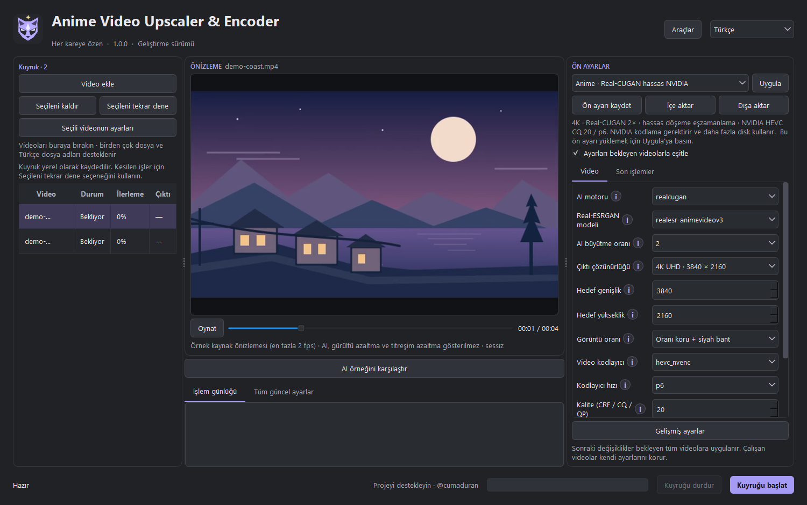
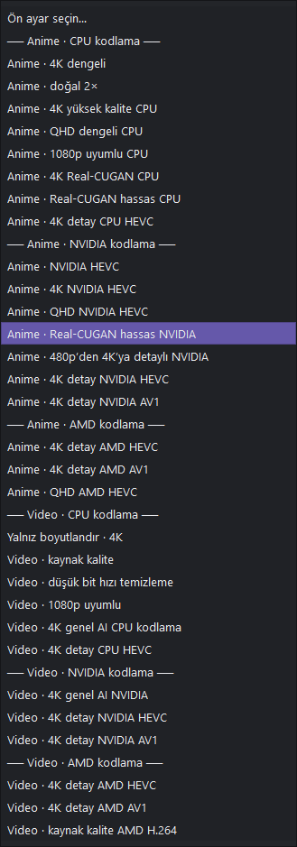
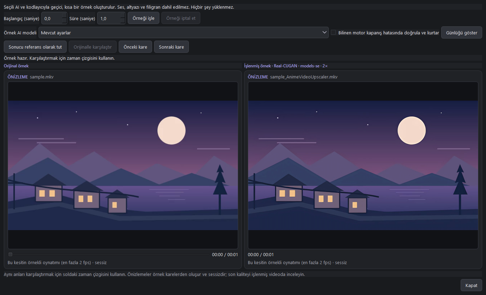
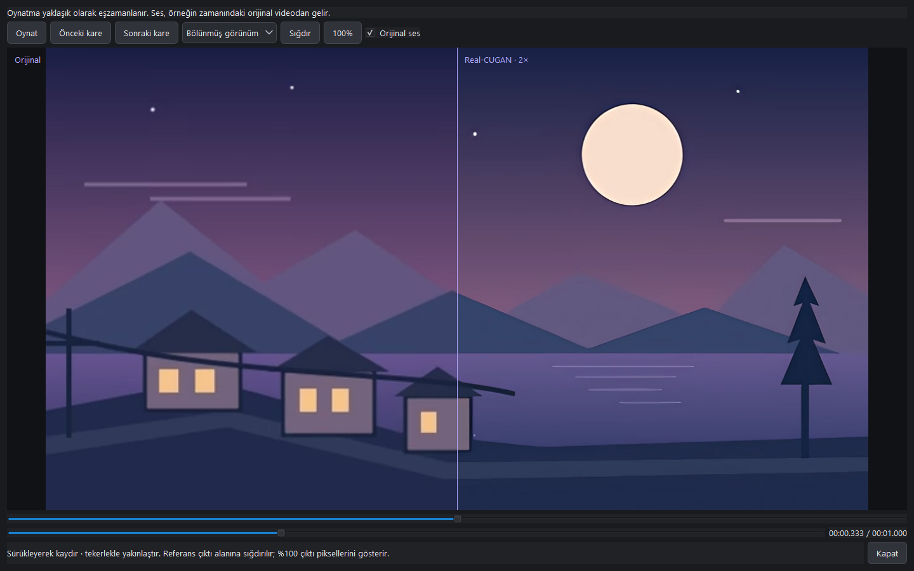
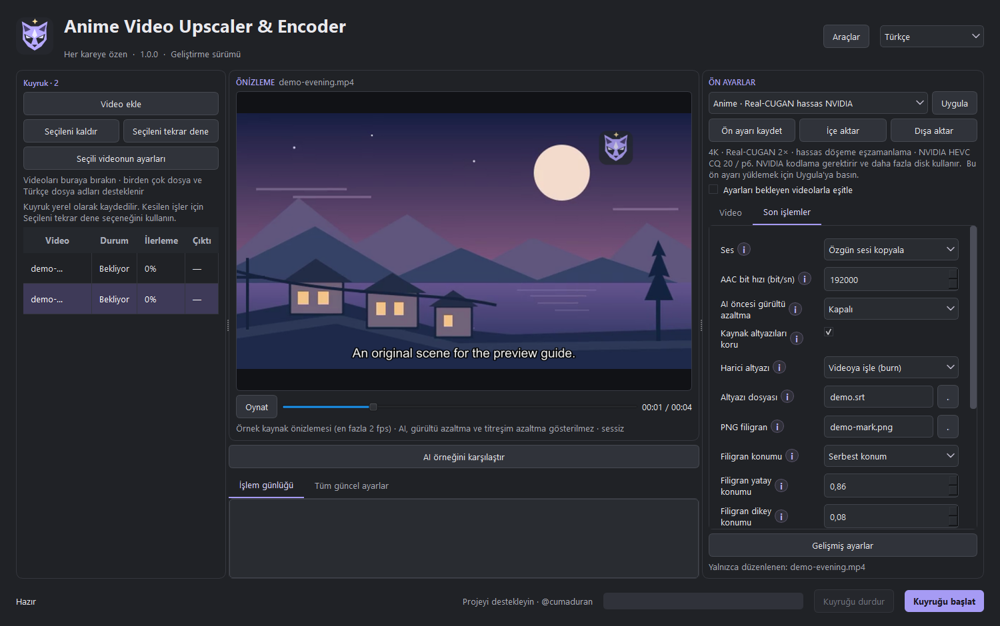
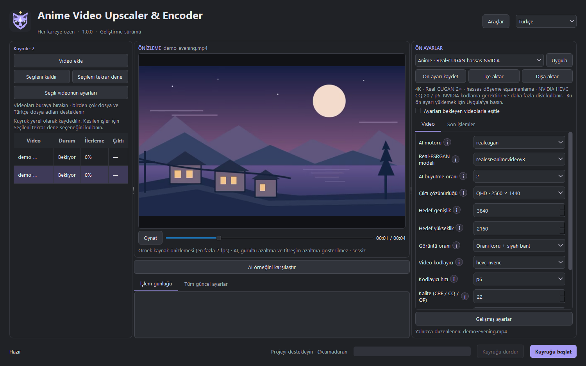
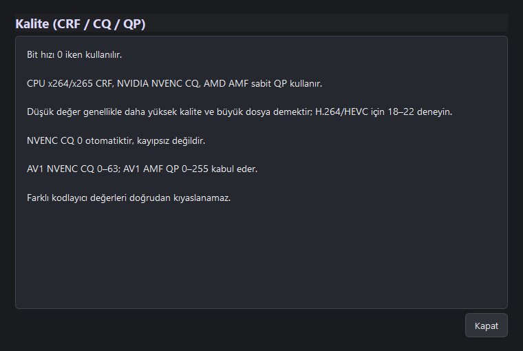
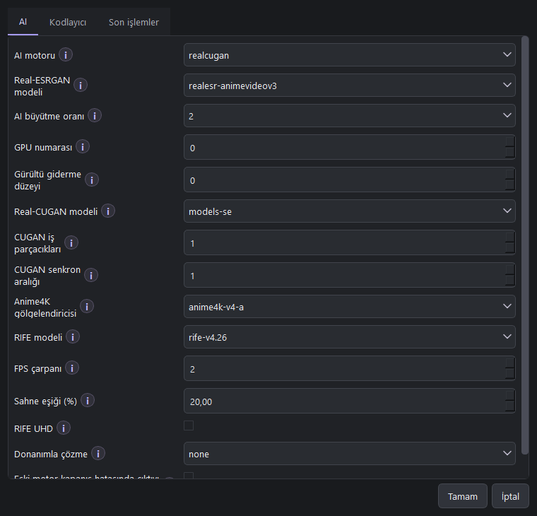
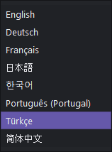
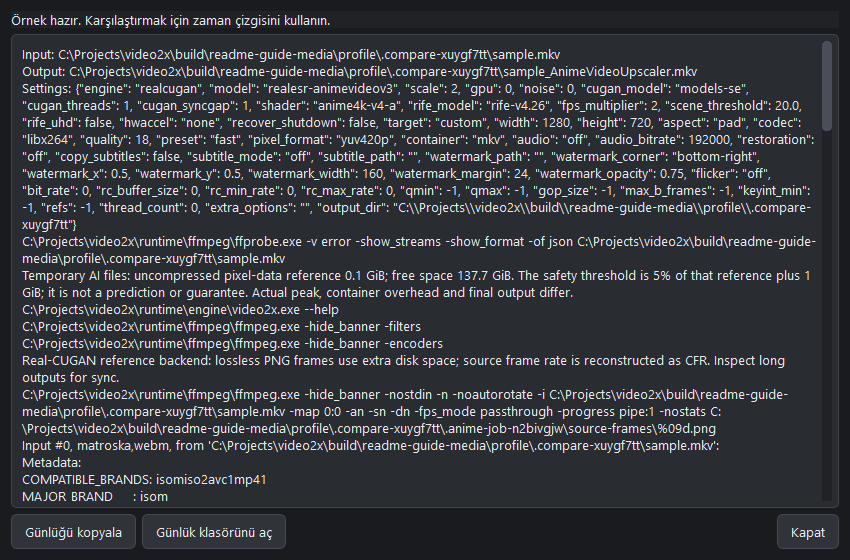

# Anime Video Upscaler & Encoder

**Windows · 1.0.0 geliştirme önizlemesi · [@cumaduran](https://github.com/cumaduran)**

[English](README.md) · **Türkçe**

Anime ve diğer videoları tek uygulamada büyüt, kısa örnekleri karşılaştır ve
kodla. İşleme başlamadan görüntü oranını, altyazıyı ve filigranı önizle.

> Uygulama geliştirme aşamasındadır. Uzun video, temiz Windows ve farklı GPU
> testleri tamamlanmadı. Büyük bir arşiv işlemeye başlamadan önce
> [mevcut sınırları](#mevcut-sınırlar) oku.

Arayüz, kuyruk, ayarlar ve ön ayarlar bu projeye aittir. Yerel AI altyapısında
K4YT3X ve katkıda bulunanların [Video2X](https://github.com/k4yt3x/video2x)
projesi temel alınmıştır. Bağımsız bir uygulamadır; özgün katkı ve lisans
bilgileri korunur.

## Önce kısa bir deneme yap

1. Taşınabilir ZIP'in **tamamını** bir klasöre çıkar ve
   `Anime Video Upscaler and Encoder.exe` dosyasını aç. `runtime`, `_internal` ve
   diğer dosyaları EXE'nin yanında tut. Video2X veya Shutter Encoder kurman gerekmez.
2. Videoları soldaki kuyruğa sürükle. Önizleme için bir video seç.
3. Sağdan bir ön ayar seçip **Uygula** düğmesine bas. Yalnızca listeden seçmek
   ayarları değiştirmez. Çözünürlük, kodlayıcı ve kaliteyi kontrol et.
4. **AI örneğini karşılaştır** ile hareketli bir sahnenin kısa örneğini işle.
5. Çıktı klasörünü seçip **Kuyruğu başlat** düğmesine bas. Toplu işlem öncesinde
   çıkan videoyu, sesi ve altyazı senkronunu kontrol et.

Başlatmadan önce seçili işler için dosyalar ve video bilgileri kontrol edilir;
bu tarama iptal edilebilir. Kodlayıcı, disk alanı ve diğer bazı kontroller her iş
başlarken de yapılır. Kuyruk sırasını seçili satırları yukarı veya aşağı taşıyarak
değiştirebilirsin. Süre tahmini kaynak video sürelerini kullanır; farklı ayarlar
ve sahneler gerçek işlem hızını değiştirebilir.

**Kuyruk hazırlık raporu** bekleyen videoların teknik bilgilerini, kodlayıcıyı ve
çıktı diskindeki boş alanı gösterir. Çalışma verisi referansı gerçek disk ihtiyacı
değildir; bazı uyumluluk kontrolleri işlem sırasında yapılır. **Kurtarma dosyalarını
yönet**, seçtiğin çıktı klasöründeki tanınan kayıtları ve kapladıkları alanı gösterir;
seçili kayıtları silmeden önce onay ister.

**Donanım uyumluluğu** bölümünde Vulkan aygıtlarını listeleyebilir ve seçili GPU
kodlayıcıyı deneyebilirsin. Aygıtın listelenmesi AI işleminin başarılı olacağını
garantilemez. Video seçilmemişse kodlayıcı denemesi küçük bir 256 × 256 örnek kullanır.

AI için uyumlu bir **Vulkan GPU ve sürücüsü** gerekir. Ön ayardaki **CPU**, son
kodlamayı anlatır; AI işleminin CPU'da çalışacağı anlamına gelmez. NVIDIA NVENC
ve AMD AMF de seçilen kodlayıcıyı destekleyen donanım ve sürücü gerektirir.
GPU sürücüsü uygulamayla birlikte dağıtılmaz.

## Ön ayarlar: anime, normal video ve donanım

Sistem ön ayarları önce **Anime / Video**, ardından **CPU / NVIDIA / AMD**
olarak gruplandırılır. Listenin altındaki açıklama, seçilen profilin ne yaptığını gösterir.

| Hedefin | Başlangıç için deneyebileceğin profil |
| --- | --- |
| 4K anime | Anime 4K veya Real-CUGAN hassas; modelleri örnekle karşılaştır |
| Daha düşük çözünürlük | Uygulamada 2K/QHD olarak geçen **2560 × 1440** profilleri |
| Düşük çözünürlüklü anime | 480p'den 4K'ya detay; çizgiler ve kaynak kullanımı için 2× ile karşılaştır |
| Normal video / gerçek çekim | Video genel AI veya detay; yalnız boyutlandırmayla karşılaştır |
| Sıkıştırılmış, gürültülü video | Video düşük bit hızı temizleme; hafif gürültü azaltmayla başla |
| Yaygın oynatıcı uyumu | 1080p uyumlu veya H.264 profilleri |
| Verimli son kodlama | HEVC; donanımın ve oynatıcın destekliyorsa AV1'i karşılaştır |
| AI kullanmadan işlem | Yalnız boyutlandır veya Video kaynak kalite |

**Ön ayarı kaydet** mevcut ayarlarını yerel olarak saklar. **Dışa aktar** ile
JSON dosyası oluşturabilir, **İçe aktar** ile geri yükleyebilirsin. Kendi
profillerin sistem ön ayarlarının yanında görünür. Başkasının ayarını içe
aktarırken dosya yollarını kontrol et.

En yüksek kalite ve en küçük dosya aynı anda garanti edilemez. Bit hızını
yükseltmek veya çıktıyı 4K yapmak, kaynakta kaybolmuş bütün ayrıntıları geri getirmez.

## AI seçenekleri ne işe yarar?

| Seçenek | Kullanım amacı |
| --- | --- |
| Real-ESRGAN | Anime video, anime detay ve genel video için ayrı modeller; büyütme oranı modele bağlıdır |
| Real-CUGAN | Anime büyütme, gürültü giderme ve döşeme eşzamanlama; çizgi ayrıntılarını kendi kaynağında karşılaştır |
| Anime4K | Gölgelendirici tabanlı görüntü işleme; sinir ağı modelleriyle karşılaştırılabilir |
| RIFE | Kare hızını artıran ara kare üretimi; çözünürlük büyütme veya titreme giderme modeli değildir |
| AI yok | AI kullanmadan boyutlandırma, son işlemler ve kodlama |

Mevcut model ağırlıkları kullanılır. Model seçmek veya filtreleri birleştirmek
yeni eğitilmiş bir model oluşturmaz.

## AI örneği: uzun işlemi başlatmadan karşılaştır

1. Kuyruktan video seçip **AI örneğini karşılaştır** düğmesine bas.
2. Başlangıç zamanını ve **0,5–10 saniye** arası örnek süresini seç.
3. **Mevcut ayarlar** veya bir örnek AI modeli seçip **Örneği işle** düğmesine bas.
4. Soldaki zaman çizgisinden aynı anları incele. **Önceki kare / Sonraki kare**
   kaynak kare aralığına göre yaklaşık adımlarla ilerler.
5. **Sonucu referans olarak tut** ile ilk sonucu sakla, başka model seçip tekrar
   işle. Böylece iki sonucu karşılaştırabilirsin. **Orijinalle karşılaştır**
   kaynak videoya döner.

İşlenen örnekler için kaynak ve çıktı bilgileri gösterilir. Aynı ayarlarla birden
fazla örnek işlenirse süre ve video boyutu tahmini gözlenen en düşük ve en yüksek
değerlerden hesaplanır; ses, altyazı ve başlangıç süresi dahil değildir.

Bu işlem bilgisayarında gerçek bir geçici çıktı oluşturur; dosya yüklenmez.
Geçici örnek dosyalarına kaynak ses, altyazı ve filigran eklenmez. İlk karşılaştırma
panelleri sessiz ve örnek karelerle çalışır. İşlem bitince **A/B karşılaştırmasını
oynat** ile gerçek hızda izle ve orijinal videodan sesi dinle. Yan yana veya bölünmüş
görünümü seç; sürükleyerek kaydır, tekerlekle yakınlaştır veya **%100** ile çıktı
piksel ölçeğini kullan. Oynatma eşzamanlaması yaklaşık olduğundan son kaliteyi ve
sesi çıktı videosunda da kontrol et. Pencere kapanınca geçici örnekler temizlenir.

Eski motorun bilinen kapanış hatası için doğrulamalı kurtarma **yalnızca bu geçici
karşılaştırmada** varsayılan açıktır. Kurtarılan sonuç uyarıyla işaretlenir;
gözle kontrol edilmesi gerekir.

Görselde özgün demo sahnesinin **bir saniyesi Real-CUGAN 2× ile 640 × 360'tan
1280 × 720'ye** işlendi. Kurtarma kullanılmadan tamamlandı. Bu bir kullanım
örneğidir; kalite ölçümü veya modelin her videoda en iyi olduğu iddiası değildir.

## Önizleme, filigran, altyazı ve son kodlama

Orta alan, **kaynak karelere son işlem önizlemesini** uygular. Konum kontrolü
için zaman çizgisini veya örnek kare oynatmayı kullan. AI, gürültü azaltma ve
titreme filtresinin işlenmiş sonucunu burada görmezsin.

**Son işlemler** sekmesinden:

- **PNG filigran**, boyut ve saydamlık seç. Serbest konumda önizlemedeki
  filigranı sürükleyebilir, sağ alt köşesinden boyutlandırabilirsin.
- Harici altyazı dosyası seç. **Burn**, metni görüntüye işler; **soft**,
  desteklenen altyazıyı seçilebilir tutar. Dosya biçimi ve kapsayıcı uyumlu olmalıdır.
- Desteklenen kaynak altyazılarını koru; sesi kopyala veya AAC olarak kodla.
- İsteğe bağlı hafif gürültü ve titreme azaltmayı önce kısa örnekte dene.

Çıktı çözünürlüğü **Video** sekmesindedir: 4K UHD **3840 × 2160**, QHD
**2560 × 1440**. Esnemeyi önlemek için görüntü oranını koru. Farklı oranlı bir
videonun tam hedef boyutta olması gerekiyorsa siyah bant ekleme seçeneğini kullan.

AI ve son işlemler aynı akışta **tek son çıktı kodlamasıyla** tamamlanır.
Yeni motor, tam uzunlukta AI ara videosu oluşturmadan kareleri aktarır. Geçici
örnekler ve son çıktı disk kullanır; eski motorlar büyük ara dosyalar oluşturabilir.

## Her videoya farklı ayar verme

**Ayarları videolar arasında eşitle** kutusu varsayılan olarak açıktır.

| Kutu | Bir ayarı değiştirdiğinde |
| --- | --- |
| Açık | İşlemde olmayan tüm videolar ortak ayarları kullanır. İşlemdeki video kendi ayarını korur. |
| Kapalı | Soldan video seçip ayrı ayarla. Tamamlanmış veya hata vermiş videoların ayarları da düzenlenebilir. |

Bu kural ön ayar, gelişmiş ayarlar ve filigran düzenlemesi için de geçerlidir.
Ayarların altındaki metin hangi videoyu veya grubu düzenlediğini gösterir.
Kutuyu yeniden açınca ekrandaki ayarlar işlemde olmayan tüm videolara hemen uygulanır.
Tamamlanmış veya hata vermiş bir videonun ayarını değiştirmek işlemi başlatmaz.
Bekleyen video yoksa videoları seçip **Kuyruğu başlat** ile güncel ayarlarla yeniden
işleyebilirsin. **Seçileni tekrar dene** de seçili videoları bekleme durumuna alır. Kuyruk ve eşitleme tercihi yerel kaydedilir.
Kesilen işler kendiliğinden başlamaz; **Seçileni tekrar dene** ile başlatılır.

## Bilgi düğmeleri ve gelişmiş ayarlar

Ayarın veya yanındaki **i** düğmesinin üzerine gelince kısa bilgi görünür.
**i** düğmesine tıklayınca değerlerin anlamını, etkilerini ve başlangıç önerisini
anlatan kaydırılabilir pencere açılır.

H.264/HEVC için **18–22** karşılaştırmaya uygun bir başlangıç aralığıdır.
Düşük CRF/CQ/QP genellikle daha yüksek kalite ve daha büyük dosya anlamına gelir;
farklı kodlayıcıların sayılarını doğrudan kıyaslama. NVENC CQ 0 otomatik değerdir,
kayıpsız çıktı garantisi değildir. Kalite modu, video bit hızı 0 iken kullanılır;
sabit bit hızı seçmek hız kontrolünü değiştirir.

**Gelişmiş ayarlar** AI, kodlayıcı ve son işlemleri gruplar. Pencerede taslak
düzenlenir; **Tamam** ayarları doğrulayıp uygular, **İptal** değişiklikleri atar.
Ana ekran ve gelişmiş pencere aynı ayar kaynağını kullanır.

## Sekiz arayüz dili

Sağ üstteki listeden dil seç. **Varsayılan dil İngilizcedir.**

English · Türkçe · Deutsch · Français · 日本語 · 한국어 · Português (Portugal) · 简体中文.

Arayüz, ön ayar açıklamaları ve yardım metinleri genişletilebilir çeviri
kataloglarından gelir. Yeni diller `app/anime_video_upscaler/locales/` altına
eklenebilir. İngilizce/Türkçe dışındaki çeviriler ana dil kontrolü bekler;
teknik günlükler ve bazı değişken hata mesajları İngilizce kalır.

## İlerleme ve hata günlükleri

Kuyrukta durum ve yüzde görünür. Orta alanda **İşlem günlüğü** ve **Tüm güncel
ayarlar** sekmeleri bulunur. İşlem hatasında günlük penceresi otomatik açılır;
karşılaştırmada ayrıca **Günlüğü göster** düğmesi vardır.

**Günlüğü kopyala** veya **Günlük klasörünü aç** ile ayrıntıları inceleyebilirsin.
Paylaşmadan önce kişisel dosya yollarını kontrol et. Disk dolması ayrı raporlanır;
kurtarılabilir motor kapanış hatası sayılmaz. Tamamlanan çıktı sessizce ezilmez.

## Mevcut sınırlar

- **AI motoru ve disk:** komut satırı motoru ve yerel kütüphane bu projenin
  değiştirilmiş Video2X tabanlı kaynaklarından derlenir. Test edilen NVIDIA sistemde
  Vulkan kaynakları kapanıştan önce bırakılır. Kareler diskte tam uzunlukta AI ara
  videosu oluşturmadan doğrudan son kodlayıcıya aktarılır. 1 GiB boş alan rezervi
  izlenir; son çıktı için ayrıca alan gerekir. Eski motorlar ara dosya ve isteğe
  bağlı kurtarma kullanır. Diğer sürücü ve uzun videolar ek test gerektirir.
- **Real-CUGAN:** kaynak derlemeli akış, mevcut ağırlıkları ve seçilen döşeme
  eşzamanlamasını kullanır. Eski motorlar için paketli referans yol PNG kareleri
  ve daha fazla disk kullanır.
- **Medya:** AI 8 bit RGB işler. PQ/HLG HDR kaynaklar BT.709 SDR'ye dönüştürülür;
  HDR parlaklık aralığı korunmaz. Eksik renk bilgisi olan BT.2020 kaynaklar
  reddedilir. 90 derecelik katlarla döndürülmüş kaynaklar düzeltilir. Bazı
  değişken kare hızı, renk, altyazı ve uzun video durumları ek test gerektirir.
  Titreme azaltma flaşları ve sahne geçişlerini etkileyebilir; çizgi ve hareket sorunlarını tamamen gidermez.
- **Donanım ve dağıtım:** AMD AMF, yeni AV1 kartları, temiz Windows ve uzun
  kuyruk testleri tamamlanmadı. AI kullanılan CPU profilleri de Vulkan GPU gerektirir.
- **Kendi modelimiz:** CMD2X/CMD4X araştırma adlarıdır; **eğitilmiş veya kullanıma
  sunulmuş model değildir**. [AI yol haritası](docs/ai-development-roadmap.md) ve
  [veri kümesi rehberi](docs/cmd-dataset-guide.md) sonraki adımları açıklar.

[Uygulama incelemesi](docs/application-review.md), geliştirme önceliklerini ve
test açıklarını anlatır. Her kaynak için en iyi tek model veya tek ön ayar yoktur.

## Windows EXE ve otomatik derleme

[Windows iş akışı](.github/workflows/windows-portable.yml), GitHub Releases
üzerinden `v` ile başlayan bir etiketle sürüm yayımlandığında taşınabilir ZIP ve
SHA-256 dosyasını o sürüme eklemek üzere hazırlanmıştır. Test hatası dosyaların
eklenmesini engeller.

Akış henüz GitHub'da çalıştırılmadı. Standart Windows sunucusu gerçek
Vulkan/NVIDIA/AMD işlemlerini test etmez. Installer oluşturulmaz. Dağıtımdan önce
temiz sistem sonuçları ve bağımlılık lisansları gözden geçirilmelidir.

Yerel kurulum, test ve taşınabilir geliştirme derlemesi için
[geliştirme rehberine](docs/anime-upscaler.md) bak. Arayüz kodu
`app/anime_video_upscaler/`, testler `tests/anime_video_upscaler/` altındadır.
Temel alınan yerel motor kaynakları `engine/core/`, `engine/include/` ve `engine/cli/` altında korunur.

## Katkı ve destek

Uygulama işine yaradıysa projeyi takip etmek ve geri bildirim vermek için
**[@cumaduran GitHub profilini](https://github.com/cumaduran)** ziyaret edebilirsin.
Uygulamanın alt çubuğunda da küçük bir **Projeyi destekleyin** bağlantısı bulunur;
yalnızca tıklandığında açılır.

Proje Video2X'in **AGPL-3.0** lisansını ve özgün katkı bilgilerini korur.
FFmpeg, Qt/PySide6, ncnn, model ağırlıkları ve diğer bağımlılıkların ayrı
lisansları vardır. Paketli geliştirme FFmpeg derlemesi GPL etkindir.
[LICENSE](LICENSE), [NOTICE](NOTICE) ve paketli kaynak bilgilerini incele.

Masaüstü iş akışı ve özgün ay tilkisi görseli: **@cumaduran**.
Ekran görüntülerinde kullanıcı videosu yerine
[özgün demo çizimi](docs/images/demo-scene.svg) kullanılmıştır.

Geliştirme klasörleri ve motorun kökeni için [proje yapısı](docs/project-structure.tr.md) belgesine bakın.
